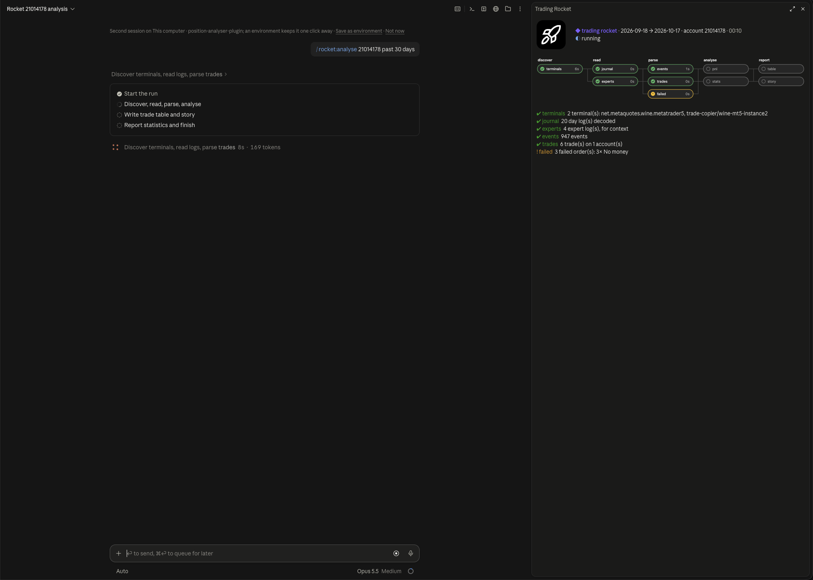
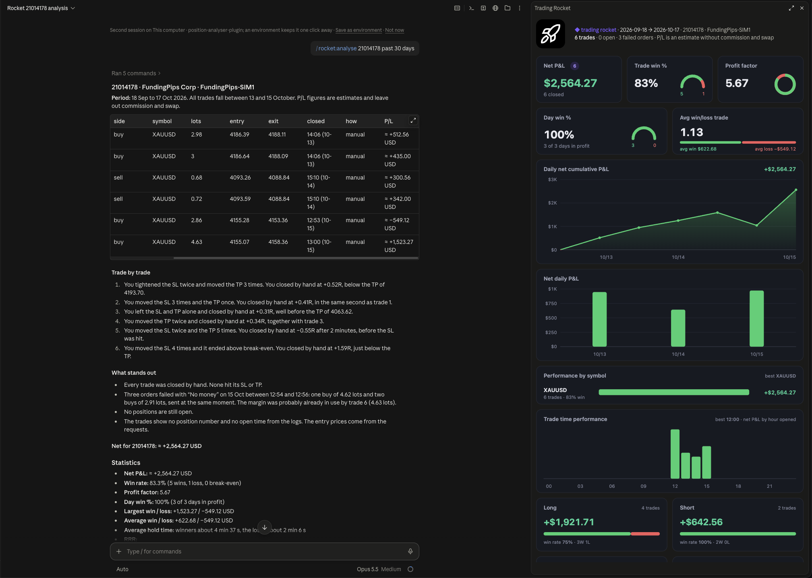
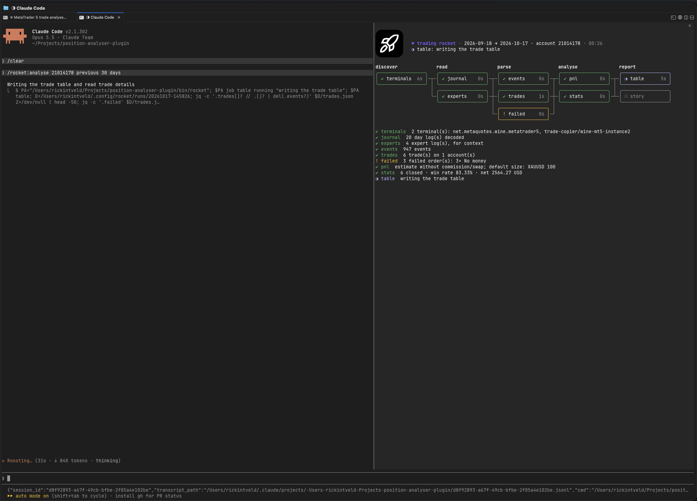
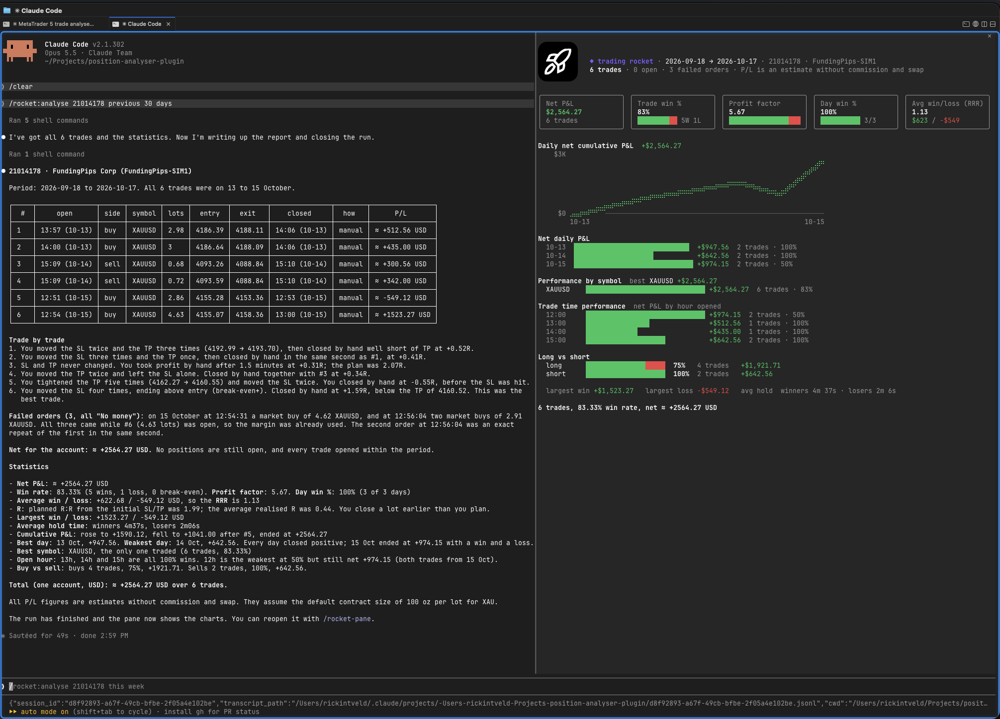

<p align="center">
  
</p>

# Trading Rocket — Claude Code plugins for traders

One plugin, `rocket`, short to type: every tool is a `/rocket:<command>`.

## /rocket:analyse

Analyse your MetaTrader 5 trades straight from the terminal logs on your Mac. No broker API,
no exports, no add-ons inside MetaTrader: the plugin reads the journal MT5 already writes,
rebuilds every trade and shows you what the data says.

```
/rocket:analyse 1234 last 30 days
```

### Watch it work

While Claude works, a pane beside the conversation shows the pipeline live: it finds your MT5
terminals, decodes the logs, rebuilds the trades and computes the numbers, each step with what it
found.



### Your trading dashboard

When the run is done, the pipeline makes way for your dashboard, while Claude writes the trade
table, a line per trade on how it went and what stands out.



- **Net P&L**, **trade win %** and **day win %**
- **Profit factor** and **average win / average loss** (your realised RRR), plus the planned R:R
  from your initial SL/TP
- **Cumulative P&L** curve and **net P&L per day**
- **Performance by symbol**, with your best symbol
- **Trade time performance**: the result per hour you opened
- **Long vs short**
- **Largest win and loss**, and how long you hold winners and losers

## Install

```
/plugin install rocket --marketplace rickintveld/position-analyser-plugin
```

Or add the marketplace first and pick the plugin from `/plugin`:

```
/plugin marketplace add rickintveld/position-analyser-plugin
```

Requirements: macOS with MetaTrader 5 (the MetaQuotes app, CrossOver or any wine prefix),
`zsh`, `jq` (built into macOS 15 and later; otherwise `brew install jq`), `awk` and `iconv`.

## Use

```
/rocket:analyse                             # today, all accounts
/rocket:analyse yesterday
/rocket:analyse 2026-10-01 2026-10-15
/rocket:analyse this week
/rocket:analyse 1234 last 7 days            # one account
/rocket:analyse 1234 5678 this month        # several accounts
```

A bare number is an account number; a date has dashes or is written in words.

Claude gives you a trade table per account (open/close time, side, symbol, lots, entry, exit,
how it was closed: manual / SL / TP / stop out / partial, P/L), a line per trade on how it went
(SL moved to break-even, TP pulled in, …), failed orders, and the statistics above.
`/rocket-pane` reopens the pane with the last run.

## For the nerds: the terminal

Prefer Claude Code in a terminal? Same pipeline, same dashboard, drawn in text.





- In a narrow terminal the pane waits instead of opening by itself; widen the window or run
  `/rocket-pane` to open it.
- The logo shows in terminals that can display pictures (Ghostty, kitty); other terminals show
  the header text without it.
- The cumulative P&L is a braille line chart (2×4 dots per character), green above zero and red
  below.

### How it works

The numbers are computed by a script, not by the model, so they are the same every time:

1. `discover` finds every MT5 terminal (`terminal64.exe`) in `~/Library/Application Support`
   (MetaQuotes app, CrossOver bottles, other wine wrappers) and `~/.wine`.
2. `read` decodes the UTF-16 journals (`logs/YYYYMMDD.log`) and expert logs (`MQL5/Logs`) of the
   period, plus a day either side for positions that run over midnight.
3. `parse` rebuilds positions from the `Trades` lines: opening deals, `close #N` requests,
   SL/TP/stop out triggers, partial closes, SL/TP modifications and failed orders, per account.
4. `analyse` computes P/L and the statistics.

**P/L is an estimate** without commission and swap: price move × lots × contract size. Default
contract sizes are XAU 100 oz, XAG 5000 oz and 100,000 for 6-letter FX pairs; for anything else
(indices, crypto, CFDs) Claude looks in the expert logs or asks you. Win rate and the per-hour,
per-symbol and long/short counts never need the contract size.

**Read-only.** Nothing is installed in or changed in MetaTrader. Everything the plugin writes
goes to `~/.config/rocket` (override with `ROCKET_HOME`). Terminals in other places:
`ROCKET_MT5_PATHS=<folder>[:<folder>]`.

### Develop

```
zsh tests/cli.zsh            # the script against a fake terminal (tests/fixtures)
claude plugin test .         # the pane
claude plugin validate .
claude --plugin-dir .        # a session with this checkout loaded
```

`bin/rocket help` lists the script's subcommands. See `CLAUDE.md` for the layout.
